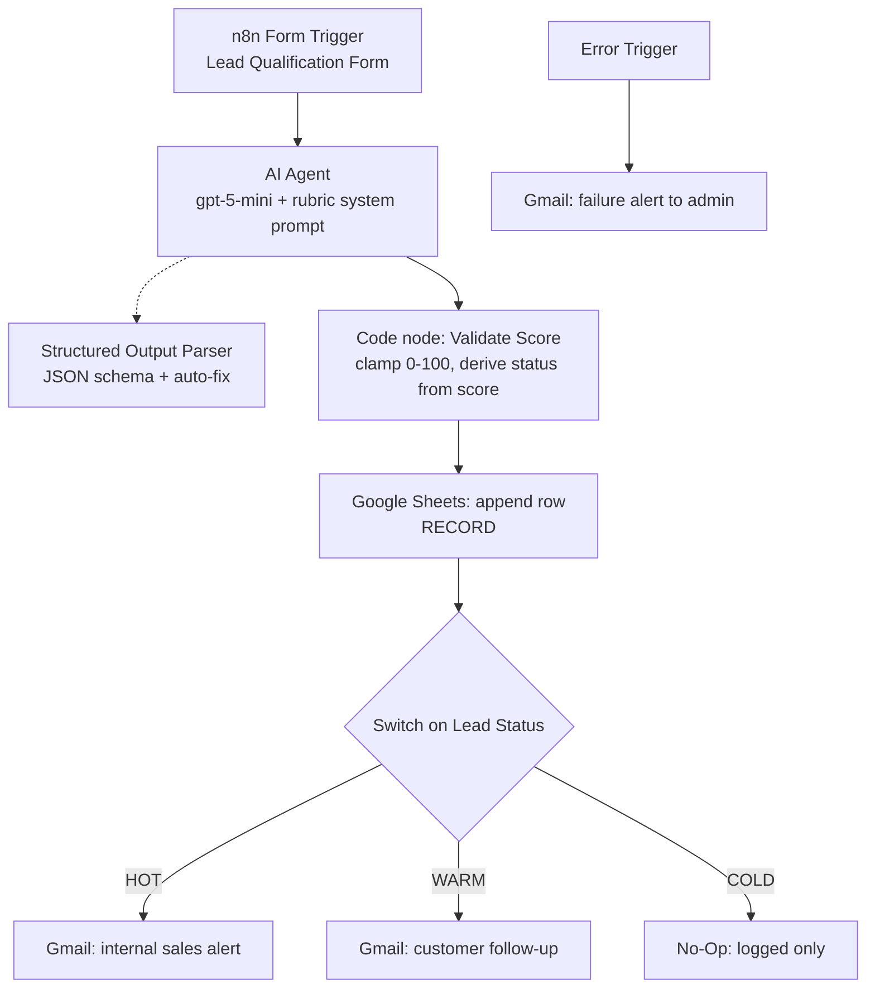

# Quantifier AI — Lead Qualification & Scoring System

An AI-powered lead qualification pipeline built with **n8n**, **OpenAI (gpt-5-mini)**, **Google Sheets**, and **Gmail**.

Every inbound lead is scored 0–100 by an LLM, classified **HOT / WARM / COLD**, logged to a Google Sheet, and routed automatically: internal alert (HOT), customer follow-up (WARM), or log-only (COLD).


---

## Why

Manual lead triage spreads attention evenly across leads regardless of conversion potential. This pipeline has an LLM do structured extraction and scoring on every submission, then routes the lead with deterministic code.

| Status | Score | Action |
|---|---|---|
| **HOT** | 80–100 | Email alert to sales team |
| **WARM** | 50–79 | Automated follow-up email to the lead |
| **COLD** | 0–49 | Logged in Sheets only (nurture later) |

---

## Architecture



**Design choice:** the LLM proposes a score; a Code node then derives `lead_status` from that score. This stops contradictions like `HOT` with a score of 62 and keeps routing deterministic.

---

## Nodes

| Node | Type | Purpose |
|---|---|---|
| AI Lead Qualification Form | Form Trigger | Collects Name, Email, Phone, Company, Service, Budget (PKR), Requirements |
| AI Lead Qualification | AI Agent (retry ×3) | Scores the lead against the rubric in `prompts/lead-qualification.txt` |
| OpenAI Chat Model | gpt-5-mini | LLM for the agent and the parser's auto-fix |
| Structured Output Parser | Output Parser | Enforces the JSON schema below |
| Validate Score | Code | Clamps score to 0–100, derives status (≥80 HOT, ≥50 WARM, else COLD) |
| RECORD | Google Sheets | Appends the lead + AI analysis as one row |
| Switch | Switch | Routes on `Lead Status` |
| HOT LEAD | Gmail | Plain-text alert to sales |
| WARM | Gmail | Plain-text follow-up to the lead |
| COLD - Logged Only | No-Op | Terminal branch for COLD |
| Error Trigger → Error Alert | Error Trigger + Gmail | Emails you when any execution fails |

### AI output schema

```json
{
  "lead_status": "HOT",
  "lead_score": 90,
  "purchase_intent": "High",
  "lead_quality": "Highly qualified lead with a clear requirement and sufficient budget.",
  "key_requirements": ["AI customer support automation", "E-commerce automation"],
  "reason": "Clear service, budget above 100,000 PKR, complete contact info, strong intent.",
  "recommended_action": "Contact the lead immediately and schedule a sales discussion."
}
```

### Scoring rubric (summary)

- **HOT:** company present, service clear, budget ≥ 100,000 PKR, full contact info, strong intent to start.
- **WARM:** company + service present, budget 30,000–99,999 PKR or flexible, moderate intent.
- **COLD:** missing info, unclear service, budget < 30,000 PKR, or general inquiry.

High budget alone never makes a lead HOT. Full prompt: [`prompts/lead-qualification.txt`](prompts/lead-qualification.txt).

---

## Setup

1. **Import:** n8n → Workflows → Import from File → `WORKFLOW.json`.
2. **Credentials:** connect your own OpenAI, Google Sheets (OAuth2) and Gmail (OAuth2) accounts. None are bundled.
3. **Google Sheet:** create a sheet tab named `Quantifier AI` with this header row:
   `Timestamp, Full Name, Email, Phone, Company, Required Service, Budget, Requirements, Lead Status, Lead Score, Purchase Intent, Lead Quality, Key Requirements, Reason, Recommended Action`
   Then format the **Phone** column as *Plain text* so leading zeros survive.
4. **Pick the sheet** in the `RECORD` node (document + tab).
5. **Set emails:** replace `YOUR_SALES_EMAIL@example.com` in `HOT LEAD` and `YOUR_ADMIN_EMAIL@example.com` in `Error Alert`.
6. **Error handling:** Workflow Settings → *Error Workflow* → select this same workflow.
7. **Activate** the workflow and open the form's production URL.

---

## Testing

| Case | Input | Expected |
|---|---|---|
| HOT | Ali Khan, ABC Solutions, AI Automation, 150000, "need AI customer support automation, want to start soon" | HOT, 80–100, High intent, sales alert |
| WARM | Usman Ahmed, XYZ Store, Chatbot Development, 60000, "interested in a chatbot, want to discuss options" | WARM, 50–79, Moderate intent, follow-up email |
| COLD | Ahmed, no company, "Not sure", 10000, "just wanted to know what services you offer" | COLD, 0–49, row logged only |

Edge cases worth testing: empty Budget, empty Company, budget typed as text ("150k"), and a leading-zero phone number.

---

## Project structure

```
quantifier-ai/
├── README.md
├── WORKFLOW.json
├── WORKFLOW.png
├── prompts/
│   └── lead-qualification.txt
└── screenshots/
    ├── hot-lead-alert.png
    ├── warm-followup.png
    └── google-sheets.png
```

---

## Security

Never commit API keys, OAuth tokens, credential IDs, your Google Sheet ID/URL, or real customer data. `WORKFLOW.json` here is sanitized; re-export it from n8n only after stripping those fields.

---

## Roadmap

- Telegram/Slack alert for HOT leads
- Calendly link in the WARM follow-up
- Duplicate-lead check (lookup by email before scoring)
- Time-delayed nurture sequence for COLD/WARM leads
- Analytics dashboard (score distribution, conversion over time)
- CRM sync (HubSpot / Salesforce)

---

## Author

**Abdullah Imran**
