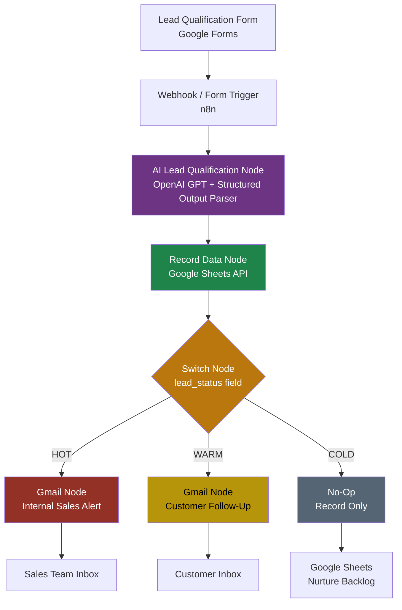
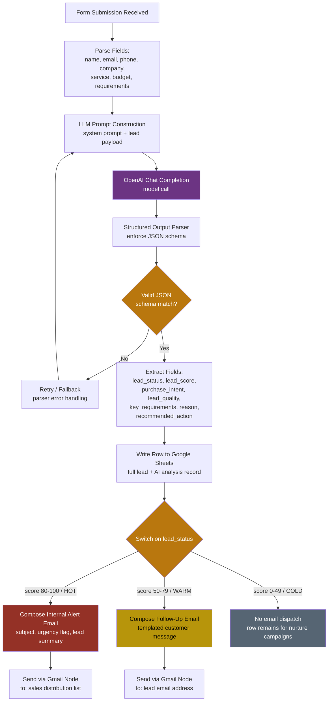

# Quantifier AI - Lead Qualification & Scoring System

An AI-powered lead qualification and scoring automation pipeline built with **n8n**, **OpenAI (GPT)**, **Google Sheets**, and **Gmail**.

The system ingests inbound lead submissions, runs them through an LLM-based qualification step, computes a 0–100 lead score, classifies the lead as **HOT / WARM / COLD**, persists the result to a structured data store, and triggers status-based routing (internal sales alert, customer follow-up, or silent logging).

---

## Project Overview

Manually triaging inbound leads doesn't scale — attention gets spread evenly across leads regardless of actual conversion potential. This pipeline automates triage by having an LLM perform structured extraction and scoring on every submission, then routes the lead deterministically based on that output.

The AI evaluates:

- Lead and contact completeness
- Company information
- Required service / product fit
- Stated or inferred budget
- Project requirements and scope
- Purchase intent signals
- Overall lead quality

Output classification:

| Status | Score Range | Definition |
|---|---|---|
| **HOT** | 80–100 | High-value lead, requires immediate sales attention |
| **WARM** | 50–79 | Viable lead, requires nurturing/follow-up |
| **COLD** | 0–49 | Low or unclear purchase intent, logged only |

---

## Architecture — Main Workflow



---

## Detailed Flow — Scoring & Routing Logic



---

## Workflow Nodes — Detail

### 1. AI Lead Qualification Form

Entry point of the pipeline. A potential customer submits structured intake data via a Google Form connected to an n8n trigger.

**Form fields:**

- Full Name
- Email Address
- Phone Number
- Company Name
- Required Service
- Estimated Budget (PKR)
- Project Requirements / Message

**Example payload:**

```
Full Name: Ali Khan
Email: ali@example.com
Phone: 03001234567
Company: ABC Solutions
Required Service: AI Automation
Budget: 150000
Requirements: We need an AI customer support automation system
for our e-commerce business and want to start the project soon.
```

---

### 2. AI Lead Qualification Node

This node sends the lead payload to an OpenAI chat completion endpoint alongside a system prompt that defines the scoring rubric. A **Structured Output Parser** node enforces a strict JSON schema on the model's response, so downstream nodes can rely on consistent field names and types instead of parsing free text.

Fields the model evaluates per lead:

- Lead quality
- Budget
- Required service
- Company information
- Contact information completeness
- Purchase intent
- Project requirements

Fields the model returns:

- `lead_status`
- `lead_score`
- `purchase_intent`
- `lead_quality`
- `key_requirements`
- `reason`
- `recommended_action`

---

### 3. Lead Scoring Rubric

Each lead receives an integer score between 0 and 100, computed by the model against the rubric below (not a hardcoded formula — the model reasons over the combination of signals).

**HOT (80–100)**
- Company name available
- Required service clearly defined
- Budget ≥ 100,000 PKR
- Complete contact information
- Strong purchase intent
- Ready to start / purchase

**WARM (50–79)**
- Company and service available
- Budget between 30,000–99,999 PKR, or flexible/negotiable
- Moderate purchase intent
- Some information still missing

**COLD (0–49)**
- Important information missing
- Unclear service requirement
- Budget below 30,000 PKR
- Weak or unclear purchase intent
- General inquiry / early-stage exploration

---

### 4. AI Output Schema

```json
{
  "lead_status": "HOT",
  "lead_score": 90,
  "purchase_intent": "High",
  "lead_quality": "Highly qualified lead with a clear requirement, sufficient budget, and strong purchase intent.",
  "key_requirements": [
    "AI customer support automation",
    "E-commerce automation"
  ],
  "reason": "The lead has a clear service requirement, a budget above 100,000 PKR, complete contact information, and strong intent to start the project.",
  "recommended_action": "Contact the lead immediately and schedule a sales discussion."
}
```

This schema is the contract between the AI node and every downstream node (Sheets write, Switch routing, email templating). Enforcing it via the Structured Output Parser is what makes the rest of the workflow deterministic despite the non-deterministic LLM call at its core.

---

### 5. Record Data — Google Sheets

Every processed lead — regardless of classification — is written as a row to a Google Sheet via the Sheets API node, giving a single source of truth for the pipeline.

**Stored columns:**

Timestamp, Full Name, Email, Phone, Company, Required Service, Budget, Requirements, Lead Status, Lead Score, Purchase Intent, Lead Quality, Key Requirements, Reason, Recommended Action

---

### 6. Switch Node — Routing Logic

The Switch node branches execution on the `lead_status` field returned by the AI node.

| Status | Route | Action |
|---|---|---|
| HOT | Gmail (internal) | Alert sent to sales distribution list for immediate contact |
| WARM | Gmail (external) | Templated follow-up email sent to the customer |
| COLD | None | Row persists in Sheets for later nurture / re-qualification |

---

## HOT Lead — Internal Alert

**Example subject:** `HOT LEAD ALERT — Immediate Attention Required`

**Alert payload includes:** customer name, email, phone, company, required service, budget, lead score, purchase intent, key requirements, reason, recommended action.

This gives the sales team full context without needing to open the Sheet.

---

## WARM Lead — Automated Follow-Up

**Example subject:** `Following Up on Your Project Inquiry`

**Example body:**

```
Hi Ali,

Thank you for sharing your project requirements with us.

We reviewed your inquiry and would be happy to learn more about
your requirements and discuss how we can help.

Our team will get in touch with you to discuss the project,
requirements, and available options.

Best regards,
Sales Team
```

---

## COLD Lead Handling

No immediate email is dispatched. The row is retained in Sheets for:

- Lead nurturing sequences
- Marketing campaign segmentation
- Scheduled re-engagement
- Retargeting
- Re-qualification on a later submission

---

## Technology Stack

| Technology | Role in Pipeline | Notes |
|---|---|---|
| **n8n** | Workflow orchestration engine | Self-hostable; handles trigger, transform, branch, and dispatch logic |
| **OpenAI API (GPT models)** | Lead analysis, scoring, and classification | Called via n8n's HTTP/OpenAI node with a rubric-based system prompt |
| **Structured Output Parser** | Schema enforcement on LLM output | Converts free-form model output into a strict, typed JSON contract |
| **Google Forms** | Lead capture / intake UI | No custom frontend required |
| **Google Sheets API** | Persistent lead datastore | Acts as lightweight CRM / system of record |
| **Gmail API** | Transactional email dispatch | Internal alerts (HOT) and customer follow-ups (WARM) |
| **n8n Switch Node** | Conditional branching | Deterministic routing based on AI-classified `lead_status` |
| **JSON** | Inter-node data contract | Ensures type-safe handoff between AI, Sheets, and email nodes |
| **OAuth2 credentials (Google, Gmail)** | Auth for Sheets/Gmail nodes | Configured per-environment, never committed to source control |

---

## Testing

### Test Case 1 — HOT Lead

```
Name: Ali Khan
Email: ali@example.com
Phone: 03001234567
Company: ABC Solutions
Service: AI Automation
Budget: 150000
Requirements: We need an AI customer support automation system
and want to start the project soon.
```

Expected: `lead_status = HOT`, `lead_score` 80–100, `purchase_intent = High`, action = internal Gmail alert.

---

### Test Case 2 — WARM Lead

```
Name: Usman Ahmed
Email: usman@example.com
Phone: 03123456789
Company: XYZ Store
Service: Chatbot Development
Budget: 60000
Requirements: We are interested in a chatbot for our website
and would like to discuss the available options.
```

Expected: `lead_status = WARM`, `lead_score` 50–79, `purchase_intent = Moderate`, action = customer follow-up email.

---

### Test Case 3 — COLD Lead

```
Name: Ahmed
Email: ahmed@example.com
Phone: 03000000000
Company:
Service: Not sure
Budget: 10000
Requirements: Just wanted to know what services you offer.
```

Expected: `lead_status = COLD`, `lead_score` 0–49, `purchase_intent = Low / Unclear`, action = record only.

---

## Security

Do not upload sensitive information to GitHub. Never expose:

- API keys
- Passwords
- OAuth tokens
- Private credentials
- Customer private information
- Authentication secrets

Always configure your own credentials when importing the workflow — none are bundled with this repository.

---

## Project Structure

```
DAY-05-AI-LEAD-QUALIFICATION/
│
├── README.md
├── WORKFLOW.json
├── WORKFLOW.png
│
├── prompts/
│   └── lead-qualification.txt
│
└── screenshots/
    ├── hot-lead-alert.png
    ├── warm-followup.png
    └── google-sheets.png
```

---

## Key Features

- AI-powered lead qualification with schema-enforced structured output
- Deterministic scoring rubric (0–100) applied via LLM reasoning
- HOT / WARM / COLD three-tier classification
- Budget-aware and intent-aware scoring
- Automated Google Sheets logging as system of record
- Real-time sales alerting for HOT leads
- Automated customer follow-up for WARM leads
- Fully automated, no manual triage step required

---

## Business Benefits

| Area | Benefit |
|---|---|
| Sales Team | HOT leads surfaced automatically, prioritization requires no manual review |
| Business | Reduces operational overhead of lead triage |
| Customer Experience | Faster, more consistent response times |
| Data Management | Every lead and its AI analysis stored in a structured, queryable format |

---

## Future Improvements

- Lead analytics dashboard (score distribution, conversion rates over time)
- Lead-to-conversion probability modeling
- WhatsApp Business API notifications
- Slack notifications for HOT leads
- Automatic meeting scheduling (Calendly/Google Calendar integration)
- CRM integration (HubSpot / Salesforce sync)
- Multi-step, time-delayed follow-up campaigns for WARM/COLD leads
- AI sales assistant for pre-call briefing
- End-to-end conversion tracking back to closed deals
- Automatic escalation rules for very high-value leads

---


## Author

### Junaid Zulfiqar
